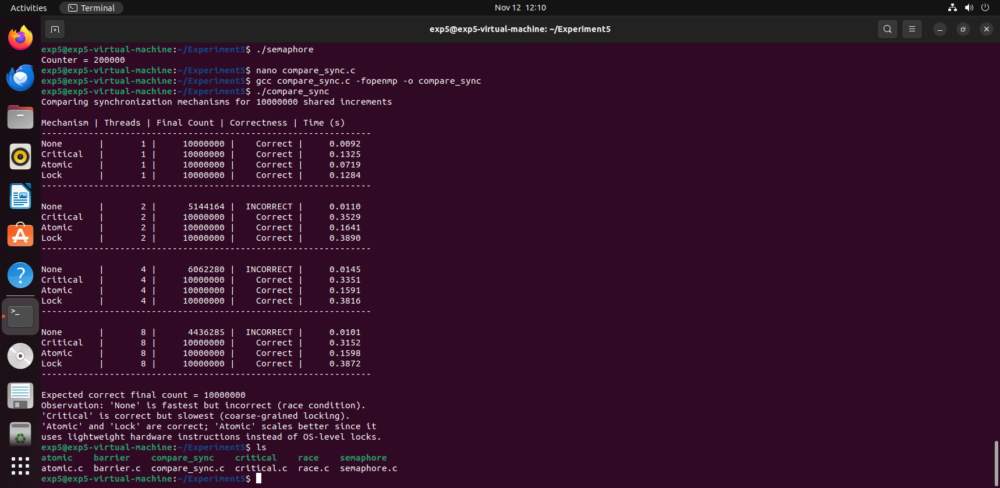

# Experiment 5: Analyze Synchronization Mechanisms in Parallel Programs

## 1. Aim

To implement and analyze different synchronization mechanisms in parallel programs and study their correctness, execution time, and scalability.

## 2. Technologies Used

- C Programming
- Ubuntu 22.04 LTS
- GCC Compiler
- OpenMP
- POSIX Threads (Pthreads)
- POSIX Semaphores
- VMware Workstation

## 3. Introduction

Synchronization is an important concept in parallel programming. Multiple threads may access shared resources simultaneously, which can lead to race conditions and incorrect results.

This experiment implements different synchronization mechanisms to control access to shared resources and maintain data consistency.

## 4. Programs Implemented

1. Race Condition (Without Synchronization)
2. Critical Section
3. Atomic Operation
4. Barrier Synchronization
5. Semaphore Synchronization
6. Comparison of Synchronization Mechanisms

---

# 5. Program Implementations

## Program 1: Race Condition (Without Synchronization)

### Objective
To demonstrate how multiple threads accessing a shared counter without synchronization can cause lost updates.

### Source Code

```c
#include <stdio.h>
#include <omp.h>

int main() {
    long counter = 0;

    #pragma omp parallel for
    for (long i = 0; i < 10000000; i++) {
        counter++;
    }

    printf("Counter = %ld\n", counter);

    return 0;
}
```

### Compilation

```bash
gcc race.c -fopenmp -o race
```

### Execution

```bash
OMP_NUM_THREADS=4 ./race
```

### Expected Result

```text
Expected Counter = 10000000
```

The actual counter may be less than the expected value because of race conditions.

---

## Program 2: Critical Section

### Objective
To prevent multiple threads from updating the shared counter simultaneously using a critical section.

### Source Code

```c
#include <stdio.h>
#include <omp.h>

int main() {
    long counter = 0;

    #pragma omp parallel for
    for (long i = 0; i < 10000000; i++) {
        #pragma omp critical
        {
            counter++;
        }
    }

    printf("Counter = %ld\n", counter);

    return 0;
}
```

### Compilation

```bash
gcc critical.c -fopenmp -o critical
```

### Execution

```bash
OMP_NUM_THREADS=4 ./critical
```

### Output

```text
Counter = 10000000
```

### Explanation
The `critical` directive allows only one thread at a time to execute the protected block.

---

## Program 3: Atomic Operation

### Objective
To perform counter updates as indivisible operations using OpenMP atomic synchronization.

### Source Code

```c
#include <stdio.h>
#include <omp.h>

int main() {
    long counter = 0;

    #pragma omp parallel for
    for (long i = 0; i < 10000000; i++) {
        #pragma omp atomic
        counter++;
    }

    printf("Counter = %ld\n", counter);

    return 0;
}
```

### Compilation

```bash
gcc atomic.c -fopenmp -o atomic
```

### Execution

```bash
OMP_NUM_THREADS=4 ./atomic
```

### Output

```text
Counter = 10000000
```

### Explanation
The atomic directive ensures that the counter increment is performed indivisibly, preventing lost updates.

---

## Program 4: Barrier Synchronization

### Objective
To synchronize multiple threads by making them wait until all threads reach a particular execution point.

### Source Code

```c
#include <stdio.h>
#include <omp.h>

int main() {

    #pragma omp parallel
    {
        printf("Thread %d before barrier\n",
               omp_get_thread_num());

        #pragma omp barrier

        printf("Thread %d after barrier\n",
               omp_get_thread_num());
    }

    return 0;
}
```

### Compilation

```bash
gcc barrier.c -fopenmp -o barrier
```

### Execution

```bash
OMP_NUM_THREADS=4 ./barrier
```

### Sample Output

```text
Thread 3 before barrier
Thread 1 before barrier
Thread 2 before barrier
Thread 0 before barrier
Thread 0 after barrier
Thread 2 after barrier
Thread 3 after barrier
Thread 1 after barrier
```

### Explanation
All threads must reach the barrier before any thread can continue beyond it. The order of printed messages may vary.

---

## Program 5: Semaphore Synchronization

### Objective
To control access to a shared counter using POSIX semaphore synchronization.

### Source Code

```c
#include <stdio.h>
#include <pthread.h>
#include <semaphore.h>

sem_t semaphore;
int counter = 0;

void* work(void* a) {
    for (int i = 0; i < 100000; i++) {
        sem_wait(&semaphore);

        counter++;

        sem_post(&semaphore);
    }

    return NULL;
}

int main() {
    pthread_t t1, t2;

    sem_init(&semaphore, 0, 1);

    pthread_create(&t1, NULL, work, NULL);
    pthread_create(&t2, NULL, work, NULL);

    pthread_join(t1, NULL);
    pthread_join(t2, NULL);

    printf("Counter = %d\n", counter);

    sem_destroy(&semaphore);

    return 0;
}
```

### Compilation

```bash
gcc semaphore.c -pthread -o semaphore
```

### Execution

```bash
./semaphore
```

### Output

```text
Counter = 200000
```

### Explanation
- `sem_init()` initializes the semaphore.
- `sem_wait()` acquires the semaphore.
- `counter++` updates the shared counter.
- `sem_post()` releases the semaphore.
- `pthread_join()` waits for both threads to finish.

---

## Program 6: Comparison of Synchronization Mechanisms

### Objective
To compare None, Critical, Atomic, and Lock mechanisms based on correctness and execution time using different thread counts.

### Source Code

```c
#include <stdio.h>
#include <omp.h>

#define N 10000000L

long run_none(int nthreads) {
    long counter = 0;
    omp_set_num_threads(nthreads);

    #pragma omp parallel for
    for (long i = 0; i < N; i++) {
        counter++;
    }

    return counter;
}

long run_critical(int nthreads) {
    long counter = 0;
    omp_set_num_threads(nthreads);

    #pragma omp parallel for
    for (long i = 0; i < N; i++) {
        #pragma omp critical
        {
            counter++;
        }
    }

    return counter;
}

long run_atomic(int nthreads) {
    long counter = 0;
    omp_set_num_threads(nthreads);

    #pragma omp parallel for
    for (long i = 0; i < N; i++) {
        #pragma omp atomic
        counter++;
    }

    return counter;
}

long run_lock(int nthreads) {
    long counter = 0;
    omp_lock_t lock;

    omp_init_lock(&lock);
    omp_set_num_threads(nthreads);

    #pragma omp parallel for
    for (long i = 0; i < N; i++) {
        omp_set_lock(&lock);
        counter++;
        omp_unset_lock(&lock);
    }

    omp_destroy_lock(&lock);
    return counter;
}

void run_and_report(const char *name, long (*fn)(int), int nthreads) {
    double start = omp_get_wtime();
    long result = fn(nthreads);
    double elapsed = omp_get_wtime() - start;

    const char *correctness = (result == N) ? "Correct" : "INCORRECT";

    printf("%-10s | %7d | %12ld | %10s | %10.4f\n",
           name, nthreads, result, correctness, elapsed);
}

int main(void) {
    int thread_counts[] = {1, 2, 4, 8};
    int num_configs = sizeof(thread_counts) / sizeof(thread_counts[0]);

    printf("Comparing synchronization mechanisms for %ld shared increments\n\n", N);
    printf("Mechanism | Threads | Final Count | Correctness | Time (s)\n");
    printf("---------------------------------------------------------------\n");

    for (int i = 0; i < num_configs; i++) {
        int t = thread_counts[i];

        run_and_report("None", run_none, t);
        run_and_report("Critical", run_critical, t);
        run_and_report("Atomic", run_atomic, t);
        run_and_report("Lock", run_lock, t);

        printf("---------------------------------------------------------------\n");
    }

    printf("\nExpected correct final count = %ld\n", N);
    printf("Observation: 'None' is fastest but incorrect (race condition).\n");
    printf("'Critical' is correct but slowest (coarse-grained locking).\n");
    printf("'Atomic' and 'Lock' are correct; 'Atomic' scales better since it\n");
    printf("uses lightweight hardware instructions instead of OS-level locks.\n");

    return 0;
}
```

### Compilation

```bash
gcc compare_sync.c -fopenmp -o compare_sync
```

### Execution

```bash
./compare_sync
```

---

# 6. Experimental Results

The comparison program performs 10,000,000 counter increments using 1, 2, 4 and 8 threads.

| Mechanism | Threads | Final Count | Correctness | Time (s) |
|---|---:|---:|---|---:|
| None | 1 | 10000000 | Correct | 0.0092 |
| None | 2 | 5144164 | Incorrect | 0.0110 |
| None | 4 | 6062280 | Incorrect | 0.0145 |
| None | 8 | 4436285 | Incorrect | 0.0101 |
| Critical | 1 | 10000000 | Correct | 0.1325 |
| Critical | 2 | 10000000 | Correct | 0.3529 |
| Critical | 4 | 10000000 | Correct | 0.3351 |
| Critical | 8 | 10000000 | Correct | 0.3152 |
| Atomic | 1 | 10000000 | Correct | 0.0719 |
| Atomic | 2 | 10000000 | Correct | 0.1641 |
| Atomic | 4 | 10000000 | Correct | 0.1591 |
| Atomic | 8 | 10000000 | Correct | 0.1598 |
| Lock | 1 | 10000000 | Correct | 0.1284 |
| Lock | 2 | 10000000 | Correct | 0.3890 |
| Lock | 4 | 10000000 | Correct | 0.3816 |
| Lock | 8 | 10000000 | Correct | 0.3872 |

*Note: These are the execution measurements from our test run. Timings and unsynchronized counter values can vary between runs.*

## 7. Output Screenshot

The final comparison output screenshot is available here:



## 8. Observations

1. The unsynchronized program demonstrated race conditions when multiple threads updated the shared counter.
2. Critical section ensured correct counter updates by allowing one thread at a time into the protected block.
3. Atomic operation ensured correct results and had lower execution time than Critical and Lock in our measurements.
4. Barrier synchronization ensured that all threads reached the synchronization point before proceeding.
5. Semaphore synchronization correctly controlled access to the shared counter.
6. Lock synchronization provided mutual exclusion but introduced locking overhead.
7. Atomic operation performed better than Critical and Lock in the tested environment.

## 9. Conclusion

The experiment successfully demonstrated different synchronization mechanisms in parallel programming using OpenMP and POSIX threads. The unsynchronized program showed race conditions and lost updates when multiple threads accessed shared data. Critical sections, atomic operations, locks and semaphores ensured correct results by controlling access to shared resources. Barrier synchronization ensured that all threads reached a particular execution point before proceeding. The comparison showed that atomic operations performed better than critical sections and locks in our test environment.

## 10. Repository Structure

```text
Experiment5/
│
├── race.c
├── critical.c
├── atomic.c
├── barrier.c
├── semaphore.c
├── compare_sync.c
├── .gitignore
├── README.md
│
└── screenshots/
    └── comparison_output.png
```

## 11. How to Run This Project

Install the required compiler and Git tools on Ubuntu:

```bash
sudo apt update
sudo apt install build-essential git -y
```

Compile and execute each C program using the commands provided in its respective section.

---

**Experiment completed successfully.**
